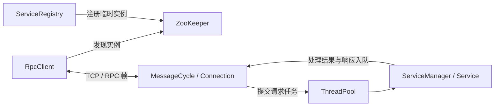

# rpc-tutorial（CookRPC）

基于 C++17 的教学型 RPC 项目，通过一个可运行的 `Echo` 服务展示 TCP 通信、服务注册与发现、负载均衡、业务调度和协议编解码。

项目提供服务端、客户端、压测工具和自动化测试，适合学习 RPC 调用链及并发资源管理。Zstd 压缩和 AES-256-GCM 加密作为独立组件提供，当前示例 RPC 链路使用明文 TCP。

## 目录

- [功能与架构](#功能与架构)
- [环境要求](#环境要求)
- [快速开始](#快速开始)
- [配置说明](#配置说明)
- [构建选项](#构建选项)
- [测试](#测试)
- [压力测试](#压力测试)
- [项目结构](#项目结构)
- [实现边界](#实现边界)
- [开发说明](#开发说明)

## 功能与架构

| 模块 | 当前能力 |
| --- | --- |
| 网络 | Linux epoll 事件循环、非阻塞 TCP、短读与短写、EOF 数据保留、受限响应发送队列 |
| 协议 | 12 字节固定头部、网络字节序、请求序列号、最大 1 MiB body、超限响应转换 |
| 服务发现 | 客户端独立 ZooKeeper 会话、查询快照、端点切换成功后提交配置 |
| 服务注册 | 持久服务目录、临时实例节点、会话所有权校验、watch 等待与过期恢复 |
| 负载均衡 | `random`、`round`、`weight`；当前 `weight` 按等权轮询执行 |
| 线程池 | 任务优先级、队列背压、按需扩缩容、统计、排空关闭和限时等待 |
| 序列化 | nlohmann-json 与 Protobuf 适配器；示例 `RpcService.Echo` 使用 JSON |
| 通用组件 | spdlog 同步日志、Zstd 压缩、OpenSSL AES-256-GCM |



服务端事件线程负责连接的读写、事件注销和关闭；工作线程处理业务并提交响应帧。客户端在一条 TCP 连接上串行执行调用，发送与接收均使用明确的等待期限。

## 环境要求

- Linux，支持 C++17 的 GCC 或 Clang，CMake 3.20 及以上。
- Threads、OpenSSL、Protobuf（含 `protoc`）、fmt、spdlog、nlohmann-json、zstd、ZooKeeper C client。
- 构建测试时需要 GoogleTest 和 Python 3；`BUILD_TESTING` 默认开启。
- 运行示例与压测时需要可访问的 ZooKeeper 服务，示例地址为 `localhost:2181`。
- 可选真实集成测试还需要 Java 和 ZooKeeper 服务端 jars。

ZooKeeper C client 必须启用同步 API。使用 vcpkg 时安装 `zookeeper[sync]`；CMake 会检查该能力，缺失时停止配置。

## 快速开始

以下操作从仓库根目录开始。先准备 vcpkg 和 ZooKeeper 服务端，再执行构建。

### 1. 安装依赖并构建

```bash
export VCPKG_ROOT=/path/to/vcpkg
export VCPKG_TARGET_TRIPLET=x64-linux

"$VCPKG_ROOT/vcpkg" install openssl protobuf fmt spdlog nlohmann-json \
  zstd 'zookeeper[sync]' gtest --triplet "$VCPKG_TARGET_TRIPLET"

./rpc_build.sh
```

如果通过系统包或其他依赖前缀安装，可以直接配置 CMake：

```bash
cmake -S . -B build -DCMAKE_BUILD_TYPE=Debug
cmake --build build --parallel
```

依赖不在默认搜索路径时，为上述配置命令追加 `-DCMAKE_PREFIX_PATH=/path/to/dependency-prefix`。构建产生 `rpc_server`、`rpc_client` 和 `stress_test_client`，Protobuf 生成文件位于 `build/generated/`。

### 2. 核对示例配置

确认 ZooKeeper 已启动，并核对以下三个文件：

- [rpc_server.json](config/rpc_server.json)：监听地址、线程池和 ZooKeeper 连接参数。
- [servers.json](config/servers.json)：注册的服务目录名及实际可访问的 `ip:port`。
- [rpc_client.json](config/rpc_client.json)：ZooKeeper 地址和待发现的实例目录。

示例监听端口与注册地址端口均为 `8989`。修改监听地址或端口时，同步修改 `servers.json`；注册地址应是客户端可访问的地址。

### 3. 启动服务端

```bash
cd build
./rpc_server ../config/rpc_server.json
```

### 4. 在另一个终端调用服务

从仓库根目录执行：

```bash
cd build
./rpc_client ../config/rpc_client.json "Hello, cookrpc"
```

成功时输出：

```json
{
  "echo": "Hello from cookrpc",
  "received_message": "Hello, cookrpc"
}
```

服务端接收 `SIGINT` 或 `SIGTERM` 后停止接收新请求，尝试发送在途响应，再等待业务任务完成并清理注册会话。普通 C++ 任务不能被安全强制终止，因此退出时间可能超过配置中的等待时间。

## 配置说明

### 客户端

| 参数 | 示例或缺省值 | 含义 |
| --- | --- | --- |
| `zk_host` / `zk_port` | `localhost` / `2181` | ZooKeeper 地址；端口范围为 1–65535 |
| `zk_namespace` | 示例为 `/cookrpc/cookrpc_service` | 要查询的实例目录；省略时为 `/cookrpc` |
| `server_port` | `8989` | 发现的地址未携带端口时使用的备用端口 |
| `timeout_ms` | `3000` | 每次 TCP 连接、发送或等待响应的期限，单位毫秒 |
| `retry_times` | `3` | 连接建立的重试次数，范围 0–100 |
| `load_balance_strategy` | `random` | 可选 `random`、`round`、`weight`；未知值回退到随机 |
| `zk_retry_interval` | `5` | ZooKeeper 建连等待的间隔单位，正整数秒，最多等待三个间隔 |

ZooKeeper 连接就绪后才提交新的客户端配置；提交时断开现有 TCP 连接，后续调用重新发现并连接服务。ZooKeeper 端点切换失败时保留当前配置和会话。各 `RpcClient` 的发现会话独立，进程内的负载均衡策略由全局 `LoadBalancer` 共享。

### 服务端与注册信息

| 参数 | 当前作用 |
| --- | --- |
| `servers_ip` / `servers_port` | TCP 监听地址与端口 |
| `max_connections` | 传给 `listen()` 的 backlog 参数，并非活动连接数量的硬上限 |
| `timeout` | 线程池退出时首次等待的毫秒数；不构成业务任务的强制执行期限 |
| `thread_pool.core_threads` / `max_threads` | 核心线程数与最大线程数 |
| `thread_pool.queue_size` | 待执行任务队列上限；设为 0 时不限制队列长度 |
| `thread_pool.keep_alive_time` | 非核心线程空闲退出时间，单位秒 |
| `scheduler.zk_host` / `zk_port` | 服务端注册与发现处理器的 ZooKeeper 地址 |
| `scheduler.retry_interval` | 毫秒值，入口转换为至少 1 秒的 ZooKeeper 等待间隔 |
| `register_config` | 服务注册配置文件路径，如 `../config/servers.json` |

`servers.json` 的 `service_name` 决定发现目录，`registry_nodes` 决定实例地址；`service_version` 当前仅作为配置元数据保存。注册根路径固定为 `/cookrpc`，修改 `scheduler.zk_namespace` 不会改写它。

发现目录名与业务分发名称用途不同：示例从 `/cookrpc/cookrpc_service` 发现地址，再调用业务服务 `RpcService` 的 `Echo` 方法。

服务端配置中的顶层及 `scheduler.load_balance_strategy` 不参与入口的策略初始化。客户端通过自己的 `load_balance_strategy` 选择策略。

直接启动可执行程序时，相对路径以进程工作目录为基准；`register_config` 也遵循此规则。示例程序的日志目录为 `../logs`，文件日志每天零点滚动。使用自定义构建目录时，可为注册配置填写绝对路径。

## 构建选项

`rpc_build.sh` 支持以下环境变量：

| 变量 | 含义 |
| --- | --- |
| `BUILD_DIR` | 构建目录；默认仓库下的 `build/`，相对路径按调用者目录解析 |
| `BUILD_TYPE` / `BUILD_JOBS` | 构建类型与并行任务数；默认 `Debug` 与 `nproc` |
| `VCPKG_ROOT` | vcpkg 根目录；未提供时尝试从 `PATH` 查找 |
| `CMAKE_TOOLCHAIN_FILE` | 显式指定工具链，优先于自动选择的 vcpkg 工具链 |
| `VCPKG_TARGET_TRIPLET` | 依赖目标 triplet，优先于 `VCPKG_DEFAULT_TRIPLET` 和宿主默认值 |

脚本将选定 triplet 显式传给 CMake，并记录工具链、triplet、依赖前缀、编译器及生成器的环境签名。签名改变后，会清除该构建目录的 `CMakeCache.txt` 和 `CMakeFiles` 再配置。

CMake 提供 `BUILD_TESTING` 和 `RPC_ENABLE_LIVE_TESTS` 两个测试开关。只构建程序时，可使用独立目录并设置 `-DBUILD_TESTING=OFF`。

## 测试

### 常规测试

```bash
ctest --test-dir build --output-on-failure
```

常规测试涵盖协议、序列化、配置、服务管理、负载均衡、线程池、压缩、加密和脚本。Linux 下还包含真实本地 TCP 测试，以及通过替换 ZooKeeper C API 控制交错的发现与注册测试；这些测试不要求启动外部 ZooKeeper。

### 真实 TCP 与 ZooKeeper 集成测试

```bash
cmake -S . -B build -DRPC_ENABLE_LIVE_TESTS=ON
cmake --build build --parallel
ctest --test-dir build -R live_tcp_zookeeper --output-on-failure
```

该测试临时启动 ZooKeeper，验证慢读背压、真实发现与调用、会话过期后的自动注册，以及 ZooKeeper 和 TCP 服务重启后的可发现性。缺少 Java 或默认 jars 时显示跳过，可通过 `ZK_SERVER_CLASSPATH` 指定安装位置。

需要保留日志时：

```bash
python3 rpc_src/test/live_test.py \
  --driver build/live_integration_test --artifacts .cache/live-test
```

### Sanitizer 检查

分别构建 ASan/UBSan 和 TSan，避免混用。使用 vcpkg 时，为下列配置命令追加相同的工具链和 triplet 参数：

```bash
cmake -S . -B build-asan -DCMAKE_BUILD_TYPE=Debug \
  -DCMAKE_CXX_FLAGS="-fsanitize=address,undefined -fno-omit-frame-pointer" \
  -DCMAKE_EXE_LINKER_FLAGS="-fsanitize=address,undefined" \
  -DCMAKE_GTEST_DISCOVER_TESTS_DISCOVERY_MODE=PRE_TEST
cmake --build build-asan --parallel
ASAN_OPTIONS=detect_leaks=1:halt_on_error=1 \
  UBSAN_OPTIONS=halt_on_error=1 ctest --test-dir build-asan --output-on-failure

cmake -S . -B build-tsan -DCMAKE_BUILD_TYPE=Debug \
  -DCMAKE_CXX_FLAGS="-fsanitize=thread -fno-omit-frame-pointer" \
  -DCMAKE_EXE_LINKER_FLAGS="-fsanitize=thread" \
  -DCMAKE_GTEST_DISCOVER_TESTS_DISCOVERY_MODE=PRE_TEST
cmake --build build-tsan --parallel
TSAN_OPTIONS=halt_on_error=1 ctest --test-dir build-tsan --output-on-failure
```

部分 Linux 环境存在 TSan 地址映射冲突，可仅为测试进程关闭 ASLR。真实测试脚本提供 `--no-aslr` 选项；常规测试可在对应环境中通过 `setarch` 启动。

## 压力测试

ZooKeeper 和 RPC 服务均已就绪时：

```bash
./stress_test.sh --threads 8 --requests 50000 --payload-size 256
```

让脚本管理本地服务端的启动与清理：

```bash
./stress_test.sh --start-server --threads 8 --requests 50000
```

使用 `--build` 可先构建。配置、构建目录和服务端日志路径均在切换目录前按调用者工作目录规范化，支持带空格的路径；例如：

```bash
./stress_test.sh --build-dir './out build' \
  --client-config './my configs/client.json' \
  --server-config './my configs/server.json' \
  --server-log './test logs/server.log' --start-server
```

压测使用多个独立客户端与长连接，并发调用 `RpcService.Echo`，校验返回消息，输出成功率、吞吐量、平均延迟及 P50/P95/P99。连接准备不计入测试窗口；延迟样本包含成功与失败调用。具体参数与环境变量见 `./stress_test.sh --help`。

## 项目结构

```text
config/                     服务端、客户端及注册节点配置
protos/                     Protobuf 消息定义
rpc_src/
  core/                     程序入口、客户端、Echo 示例、错误码
  network/                  socket、连接与事件循环
  conn_balancer/            负载均衡与 ZooKeeper 服务发现
  registry/                 ZooKeeper 服务注册与恢复
  thread_pool/              线程池与单例访问入口
  load_config/              配置解析
  protocol/                 RPC 帧编解码
  serializer/               JSON / Protobuf 适配器
  compress_data/            Zstd 组件
  encrypt/                  AES-256-GCM 组件
  tools/                    压测客户端
  test/                     单元、并发、脚本及真实集成测试
utils/                      日志与工具函数
```

## 实现边界

- 压缩和加密组件尚未接入 RPC 主链路；使用 AES 组件时，`COOKRPC_MASTER_KEY_HEX` 可注入 64 位十六进制主密钥，缺省密钥仅在当前进程中有效。
- 外层 RPC 帧使用自定义二进制协议；`protos/message.proto` 提供生成消息和序列化测试，不替代当前外层协议。
- `weight` 当前等权执行，服务发现使用实时查询，没有动态负载权重、发现缓存或长期实例列表 watch。
- 同一客户端的调用串行执行；`AsyncCall` 由后台任务调用同步接口，调用方需保证客户端存活至任务结束。
- 日志当前为同步写入；没有业务限流、熔断、自动业务重试、调用级取消或独立监控服务。
- 网络层保留 macOS/kqueue 分支，完整构建脚本及集成测试以 Linux 为验证环境。

## 开发说明

内部头文件使用 `#include "connection.h"` 等不带模块目录的形式，搜索路径由 `rpc_common` 的 CMake 配置提供。新增模块时同步维护 include 路径；第三方头文件保持其标准路径。

修改 `.proto` 后重新构建，CMake 会在构建目录生成 C++ 文件。提交前检查 `git diff --check`，并根据变更运行相关测试及完整 CTest。

设计原理、实现边界和面试问答见 [项目问题答案](docs/项目问题答案.md)；题目列表见 [项目问题](docs/项目问题.md)。
