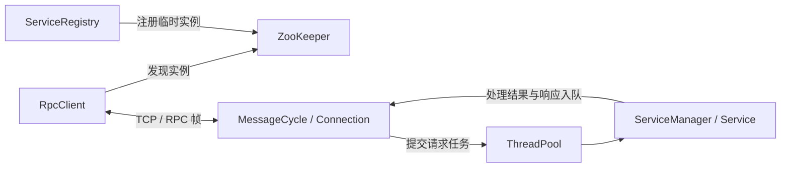

# rpc-tutorial（CookRPC）

基于 C++17 的教学型 RPC 项目，通过一个可运行的 `Echo` 服务展示 TCP 通信、服务注册与发现、负载均衡、业务调度和协议编解码。

项目提供服务端、客户端、压测工具和自动化测试，适合学习 RPC 调用链及并发资源管理。RPC 收发链路支持可配置的 Zstd 压缩与 AES-256-GCM 消息加密，并提供服务端请求限流和客户端实例熔断。示例启用压缩，加密需显式配置共享密钥。

## 目录

- [功能与架构](#功能与架构)
- [环境要求](#环境要求)
- [快速开始](#快速开始)
- [配置说明](#配置说明)
- [构建选项](#构建选项)
- [测试](#测试)
- [压力测试](#压力测试)
- [项目结构](#项目结构)
- [实现边界](#实现边界)
- [开发说明](#开发说明)

## 功能与架构

| 模块 | 当前能力 |
| --- | --- |
| 网络 | Linux epoll 事件循环、非阻塞 TCP、短读与短写、EOF 数据保留、连接容量与响应队列限制 |
| 协议 | 12 字节固定头部、网络字节序、请求序列号、最大 1 MiB body、超限响应转换 |
| 服务发现 | 客户端独立 ZooKeeper 会话、查询快照、端点切换成功后提交配置 |
| 服务注册 | 持久服务目录、临时实例节点、会话所有权校验、watch 等待与过期恢复 |
| 负载均衡 | `random`、`round`、`weight`；当前 `weight` 按等权轮询执行 |
| 线程池 | 任务优先级、队列背压、按需扩缩容、统计、排空关闭和限时等待 |
| 序列化 | nlohmann-json 与 Protobuf 适配器；示例 `RpcService.Echo` 使用 JSON |
| 流量保护 | 服务端令牌桶限流、客户端按实例熔断、冷却后的单次探测 |
| 传输编码 | 阈值压缩、AES-256-GCM、认证帧头与方向、压缩与加密配置校验 |
| 通用组件 | spdlog 同步日志、Zstd 与 OpenSSL 组件 |



fd 或 socket 资源不足时，监听读事件暂停并按 100 毫秒至 1 秒退避恢复，已有连接继续处理。服务端事件线程每轮最多接入 64 个连接，并负责连接的读写、事件注销和关闭；工作线程解码、解压和解密请求，处理业务并编码、提交响应帧。客户端在一条 TCP 连接上串行执行调用，发送与接收均使用明确的等待期限。

## 环境要求

- Linux，支持 C++17 的 GCC 或 Clang，CMake 3.20 及以上。
- Threads、OpenSSL、Protobuf（含 `protoc`）、fmt、spdlog、nlohmann-json、zstd、ZooKeeper C client。
- 构建测试时需要 GoogleTest 和 Python 3；`BUILD_TESTING` 默认开启。
- 运行示例与压测时需要可访问的 ZooKeeper 服务，示例地址为 `localhost:2181`。
- 可选真实集成测试还需要 Java 和 ZooKeeper 服务端 jars。
- 构建与压测脚本需要 Bash 和 GNU 命令行工具，压测脚本还需要 util-linux 的 `setsid`。

ZooKeeper C client 必须启用同步 API。使用 vcpkg 时安装 `zookeeper[sync]`；CMake 会检查该能力，缺失时停止配置。该依赖是链接到 RPC 程序的 C 客户端库，不会安装或启动 ZooKeeper 服务端。

当前示例通过 ZooKeeper 注册和发现服务，运行 RPC 服务端、客户端及压测工具时必须有可访问的 ZooKeeper 服务。仅构建项目和运行常规测试不要求启动外部 ZooKeeper。

## 快速开始

先满足[环境要求](#环境要求)，自行切换到仓库根目录后执行项目命令。

### 1. 启动 ZooKeeper

**已安装并配置 ZooKeeper：** 服务已经运行则跳过。通过 Ubuntu / Debian 的 `zookeeper` 软件包安装时，启动脚本位于以下路径：

```bash
sudo /usr/share/zookeeper/bin/zkServer.sh start
```

该启动方式读取 `/etc/zookeeper/conf/zoo.cfg`；项目的 `config/zoo.cfg` 由下面的 `zk_start.sh` 使用。

官方二进制解压包使用其实际安装目录中的 `bin/zkServer.sh`。仅通过 vcpkg 安装 `zookeeper[sync]` 时，得到的是 C 客户端库，不包含服务端或启动脚本，需要先安装下面的服务端组件。

**尚未配置 ZooKeeper：** 可以使用项目提供的 [config/zoo.cfg](config/zoo.cfg)。Ubuntu / Debian 尚未安装相关组件时，先执行：

```bash
sudo apt-get update
sudo apt-get install default-jre-headless zookeeper libslf4j-java
```

随后在仓库根目录执行：

```bash
./zk_start.sh
```

脚本使用提供的配置、创建数据目录并启动 ZooKeeper，默认端口 `2181`。保持该终端运行，按 `Ctrl+C` 停止。使用官方二进制发行包时，先执行 `export ZOOKEEPER_HOME=/实际解压目录`，再执行同一脚本。

### 2. 核对连接配置

将以下配置改为实际使用的地址：

| 文件 | 配置项 | 含义 |
| --- | --- | --- |
| [config/rpc_server.json](config/rpc_server.json) | `scheduler.zk_host` / `zk_port` | ZooKeeper 地址与端口 |
| [config/rpc_client.json](config/rpc_client.json) | `zk_host` / `zk_port` | 与服务端连接同一套 ZooKeeper |
| [config/servers.json](config/servers.json) | `registry_nodes[].address` / `port` | 客户端可访问的 RPC 服务端 IPv4 与端口，端口默认 `8989` |

跨设备访问时，ZooKeeper 的监听地址需允许两端连接，并放行 TCP `2181` 和 RPC 端口；使用提供的 `zoo.cfg` 时，将 `clientPortAddress` 改为 ZooKeeper 设备的可访问 IPv4，修改后重启 ZooKeeper。注册地址使用实际服务器 IP，`0.0.0.0` 仅用于监听。

服务端会自动创建 `/cookrpc/cookrpc_service` 持久目录并注册临时实例节点，无需手动创建节点。

### 3. 编译并启动项目

编译只需执行：

```bash
sh rpc_build.sh
```

在一个终端启动服务端：

```bash
./build/rpc_server
```

看到 `RPC server started on 0.0.0.0:8989` 后，保持服务端运行，在另一个终端执行：

```bash
./build/rpc_client
```

成功时返回：

```json
{
  "echo": "Hello from cookrpc",
  "received_message": "Hello, cookrpc"
}
```

客户端调用完成后退出，ZooKeeper 和 RPC 服务端需保持运行。

## 配置说明

### 客户端

| 参数 | 示例或缺省值 | 含义 |
| --- | --- | --- |
| `zk_host` / `zk_port` | `localhost` / `2181` | ZooKeeper 地址；端口范围为 1–65535 |
| `zk_namespace` | 示例为 `/cookrpc/cookrpc_service` | 要查询的实例目录；省略时为 `/cookrpc` |
| `server_port` | `8989` | 发现的地址未携带端口时使用的备用端口 |
| `timeout_ms` | `3000` | 每次 TCP 连接、发送或等待响应的期限，单位毫秒 |
| `retry_times` | `3` | 连接建立的重试次数，范围 0–100 |
| `load_balance_strategy` | `random` | 可选 `random`、`round`、`weight`；未知值回退到随机 |
| `zk_retry_interval` | `5` | ZooKeeper 建连等待的间隔单位，正整数秒，最多等待三个间隔 |

ZooKeeper 连接就绪后才提交新的客户端配置；提交时断开现有 TCP 连接，后续调用重新发现并连接服务。ZooKeeper 端点切换失败时保留当前配置和会话。异步任务持有共享客户端会话，销毁客户端对象后，已发起的任务仍可完成并通过 future 取得结果；实际调用在同一会话上串行执行。各 `RpcClient` 的发现会话独立，进程内的负载均衡策略由全局 `LoadBalancer` 共享。

### 服务端与注册信息

| 参数 | 当前作用 |
| --- | --- |
| `servers_ip` / `servers_port` | TCP 监听地址与端口 |
| `max_connections` | 活动连接硬上限，默认 10000；达到上限时关闭新接入连接 |
| `listen_backlog` | 传给 `listen()` 的等待队列参数，默认 1024 |
| `timeout` | 线程池退出时首次等待的毫秒数；不构成业务任务的强制执行期限 |
| `thread_pool.core_threads` / `max_threads` | 核心线程数与最大线程数 |
| `thread_pool.queue_size` | 待执行任务队列上限；设为 0 时不限制队列长度 |
| `thread_pool.keep_alive_time` | 非核心线程空闲退出时间，单位秒 |
| `scheduler.zk_host` / `zk_port` | 服务端注册与发现处理器的 ZooKeeper 地址 |
| `scheduler.retry_interval` | 毫秒值，入口转换为至少 1 秒的 ZooKeeper 等待间隔 |
| `register_config` | 服务注册配置文件路径，相对路径按服务端配置所在目录解析，如 `servers.json` |

监听和注册地址使用标准 IPv4 文本，配置与 socket 层采用相同校验，拒绝前导零、空白和嵌入 NUL。

数值配置只接受范围内的整数，拒绝布尔值、浮点数和溢出值。服务端及子配置全部解析、校验成功后统一提交；注册配置重新加载时替换实例列表。配置加载不代表运行中的监听地址或线程池支持热更新。

`servers.json` 的 `service_name` 决定发现目录，`registry_nodes` 决定实例地址；`service_version` 当前仅作为配置元数据保存。注册根路径固定为 `/cookrpc`，修改 `scheduler.zk_namespace` 不会改写它。

发现目录名与业务分发名称用途不同：示例从 `/cookrpc/cookrpc_service` 发现地址，再调用业务服务 `RpcService` 的 `Echo` 方法。

服务端配置中的顶层及 `scheduler.load_balance_strategy` 不参与入口的策略初始化。客户端通过自己的 `load_balance_strategy` 选择策略。

服务端、客户端和压测程序从仓库根目录启动，默认读取 `config/` 下的配置，日志写入 `logs/`。这些相对路径按进程工作目录解析，由用户在启动前切换到仓库根目录。文件日志每天零点滚动，文件名为 `cookrpc_YYYY-MM-DD.log`。

命令行传入的相对配置路径也按进程工作目录解析。服务端配置中的 `register_config` 相对路径按该服务端配置所在目录解析，绝对路径直接使用。

ZooKeeper 注册使用覆盖排队、创建、检查和 watch 等待的总期限。结果不确定的超时会话由后台退役，关闭或过期后清理临时节点，并以新会话恢复已确认注册。

服务端接收 `SIGINT` 或 `SIGTERM` 后停止接收新请求，尝试发送在途响应，再等待业务任务完成并清理注册会话。普通 C++ 任务不能被安全强制终止，因此退出时间可能超过配置中的等待时间。

### 压缩、加密、限流与熔断

客户端和服务端均可配置 `transport`。示例启用 Zstd 压缩，body 达到 1024 字节时尝试压缩，只有压缩后更小才使用压缩结果。两端的 `compression` 和 `encryption` 必须一致；模式不匹配、未知标志、错误密钥或认证失败会拒绝通信，不会自动退回明文。

```json
"transport": {
  "compression": true,
  "compression_threshold": 1024,
  "encryption": false
}
```

开启消息加密时，将两份配置中的 `encryption` 改成 `true`，并在启动服务端和客户端的各自终端中设置**相同**的 `COOKRPC_MASTER_KEY_HEX`。可用以下命令生成一次 32 字节密钥，再将其安全注入两端；不要分别生成两把密钥，也不要把密钥写进配置或仓库。

```bash
openssl rand -hex 32
export COOKRPC_MASTER_KEY_HEX='<同一份64个十六进制字符的密钥>'
```

RPC 加密必须使用显式共享密钥，缺失或格式错误时配置加载失败。AES-256-GCM 使用随机 nonce，并认证帧头、变换标志和请求/响应方向；认证成功后才解压和解析业务。加密连接拒绝重复或倒退的请求序列号，但没有跨连接的持久防重放、证书认证或密钥协商。该能力是消息加密，不能替代完整 TLS 会话安全。[OpenSSL AEAD 接口说明](https://docs.openssl.org/master/man3/EVP_EncryptInit/)

未启用传输变换时保留 `CRPC` 格式。启用后使用 `CRP1` 魔数、相同的 12 字节头部及一字节变换标记；编码后的 wire body 与解压后的逻辑 body 均限制为 1 MiB。业务响应超限，包括加密膨胀导致的超限，会转换为保留序列号的短错误响应；请求超限则在发送前失败。

服务端配置 `rate_limit`，令牌桶限制整个服务端进程接收的请求总速率，在投递线程池前检查。超限返回错误码 `3005`，不会断开正常连接。`requests_per_second` 为 `0` 时关闭限流；启用时 `burst` 必须大于 `0`，表示允许的突发请求数。

```json
"rate_limit": {
  "requests_per_second": 1000,
  "burst": 2000
}
```

客户端配置 `circuit_breaker`，按发现的实例地址隔离状态。连续远端建连、收发或协议失败达到阈值后暂时避开该实例；冷却结束允许一次探测，成功恢复，失败重新冷却。有效业务错误和限流响应不计入故障次数。本地套接字创建或选项初始化失败不计入实例故障，资源恢复后无需等待熔断冷却。请求、响应类型与序列化格式在建连和发送前校验，不兼容时作为本地错误返回。只有目录及全部实例数据读取成功时，才按发现结果清理缺失实例的熔断状态；部分读取失败会保留原有故障历史。`failure_threshold` 为 `0` 时关闭熔断。

```json
"circuit_breaker": {
  "failure_threshold": 5,
  "reset_timeout_ms": 5000
}
```

已发送的业务请求不会自动重试，调用方应根据业务幂等性决定是否再次调用。限流会影响压测成功率；测量容量时应明确记录或调整限流配置。`ServiceManager::HandleRpcRequestAsync()` 返回 `future<AsyncResult>`，结果包含 `success` 和拥有数据的 `data`，无需传入供后台任务写入的引用。

## 构建选项

使用已安装的 vcpkg 准备构建依赖时，将路径替换为实际安装目录。x86_64 Linux 使用 `x64-linux`，ARM64 Linux 使用 `arm64-linux`：

```bash
export VCPKG_ROOT=/path/to/vcpkg
export VCPKG_TARGET_TRIPLET=x64-linux
"$VCPKG_ROOT/vcpkg" install openssl protobuf fmt spdlog nlohmann-json zstd 'zookeeper[sync]' gtest --triplet "$VCPKG_TARGET_TRIPLET"
```

构建时保持这些环境变量有效，也可以写入 shell 配置。构建脚本不会自动安装依赖。

`rpc_build.sh` 支持以下环境变量：

| 变量 | 含义 |
| --- | --- |
| `BUILD_DIR` | 构建目录；默认仓库下的 `build/`，相对路径按调用者目录解析 |
| `BUILD_TYPE` / `BUILD_JOBS` | 构建类型与并行任务数；默认 `Debug` 与 `nproc` |
| `VCPKG_ROOT` | vcpkg 根目录；未提供时尝试从 `PATH` 查找 |
| `CMAKE_TOOLCHAIN_FILE` | 显式指定工具链，优先于自动选择的 vcpkg 工具链 |
| `CMAKE_PREFIX_PATH` | 额外依赖安装前缀；通过环境变量提供给 CMake 的依赖查找 |
| `VCPKG_TARGET_TRIPLET` | 依赖目标 triplet，优先于 `VCPKG_DEFAULT_TRIPLET` 和宿主默认值 |

脚本将选定 triplet 显式传给 CMake，并记录工具链、triplet、依赖前缀、编译器及生成器的环境签名。签名改变后，会清除该构建目录的 `CMakeCache.txt` 和 `CMakeFiles` 再配置。

CMake 提供 `BUILD_TESTING` 和 `RPC_ENABLE_LIVE_TESTS` 两个测试开关。只构建程序时，可使用独立目录并设置 `-DBUILD_TESTING=OFF`。

## 测试

### 常规测试

```bash
ctest --test-dir build --output-on-failure
```

常规测试涵盖协议、序列化、配置、服务管理、负载均衡、线程池、压缩、加密、日志滚动和脚本。Linux 下还包含真实本地 TCP 测试，以及通过替换 ZooKeeper C API 控制交错的发现与注册测试；这些测试不要求启动外部 ZooKeeper。压测客户端回归使用真实 TCP，仅替换发现 API，验证错误响应类型计为失败而不会终止进程。

### 真实 TCP 与 ZooKeeper 集成测试

```bash
cmake -S . -B build -DRPC_ENABLE_LIVE_TESTS=ON
cmake --build build --parallel
ctest --test-dir build -R 'live_tcp_zookeeper|startup_regression' --output-on-failure
```

这些测试临时启动 ZooKeeper，验证慢读背压、真实发现与调用、会话过期后的自动注册，以及 ZooKeeper 和 TCP 服务重启后的可发现性。启动测试按快速开始的说明，从仓库根目录启动 ZooKeeper、服务端和客户端，验证默认配置与 Echo 调用。缺少 Java 或默认 jars 时显示跳过，可通过 `ZK_SERVER_CLASSPATH` 指定安装位置。

需要保留日志时：

```bash
python3 rpc_src/test/live_test.py \
  --driver build/live_integration_test --artifacts .cache/live-test
```

### Sanitizer 检查

分别构建 ASan/UBSan 和 TSan，避免混用。使用 vcpkg 时，为下列配置命令追加相同的工具链和 triplet 参数：

```bash
cmake -S . -B build-asan -DCMAKE_BUILD_TYPE=Debug \
  -DCMAKE_CXX_FLAGS="-fsanitize=address,undefined -fno-omit-frame-pointer" \
  -DCMAKE_EXE_LINKER_FLAGS="-fsanitize=address,undefined" \
  -DCMAKE_GTEST_DISCOVER_TESTS_DISCOVERY_MODE=PRE_TEST
cmake --build build-asan --parallel
ASAN_OPTIONS=detect_leaks=1:halt_on_error=1 \
  UBSAN_OPTIONS=halt_on_error=1 ctest --test-dir build-asan --output-on-failure

cmake -S . -B build-tsan -DCMAKE_BUILD_TYPE=Debug \
  -DCMAKE_CXX_FLAGS="-fsanitize=thread -fno-omit-frame-pointer" \
  -DCMAKE_EXE_LINKER_FLAGS="-fsanitize=thread" \
  -DCMAKE_GTEST_DISCOVER_TESTS_DISCOVERY_MODE=PRE_TEST
cmake --build build-tsan --parallel
TSAN_OPTIONS=halt_on_error=1 ctest --test-dir build-tsan --output-on-failure
```

部分 Linux 环境存在 TSan 地址映射冲突，可仅为测试进程关闭 ASLR。真实测试脚本提供 `--no-aslr` 选项；常规测试可在对应环境中通过 `setarch` 启动。

## 压力测试

先启动 ZooKeeper 和 RPC 服务端，再从仓库根目录运行脚本。

默认使用 10 个并发客户端，每个发送 100 个请求，共 1000 个请求：

```bash
./stress_test.sh
```

50 个并发客户端，每个发送 200 个请求，共 10000 个请求：

```bash
./stress_test.sh -c 50 -r 200
```

20 个并发客户端，持续测试 120 秒：

```bash
./stress_test.sh -c 20 -t 120
```

| 参数 | 含义 | 默认值 |
| --- | --- | --- |
| `-c N` / `--threads N` | 并发客户端数，范围 1–1024 | `10` |
| `-r N` / `--requests-per-client N` | 每个客户端发送的请求数，合计最多 1000 万 | `100` |
| `-t N` / `--duration N` | 测试时长，单位秒，范围 1–86400 | 按请求数测试 |
| `--payload-size N` | 每次 Echo 的消息字节数 | `64` |
| `-h` / `--help` | 查看全部选项 | — |

`-r` 与 `-t` 不能同时使用。连接准备完成后开始计时，到期停止发起新请求，等待在途调用完成后输出结果。报告包含请求数、成功率、吞吐量、平均延迟及 P50/P95/P99；时长模式采用固定大小延迟直方图，百分位为近似值，平均与最大延迟按全部调用统计。请求失败时返回非零退出码。

原有 `--requests N` 仍表示所有客户端合计的请求数，与 `-r`、`-t` 互斥；例如 `./stress_test.sh --threads 8 --requests 50000`。

需要脚本管理服务端时，加上 `--start-server`；需要先编译时，加上 `--build`：

```bash
./stress_test.sh --start-server -c 50 -r 200
```

通过 `--client-config`、`--server-config`、`--build-dir` 和 `--server-log` 指定其他配置与目录。相对路径按调用者工作目录解析，支持包含空格的路径。脚本从仓库根目录运行子进程，RPC 文件日志写入 `logs/`；服务端控制台输出默认保存到构建目录的 `stress_test_server.log`。

脚本只清理自己创建的进程组。`Ctrl+C` 返回 `130`，`SIGTERM` 返回 `143`，停止宽限期默认 10 秒，可通过 `--shutdown-timeout` 设置为 1–60 秒。更多选项与环境变量见 `./stress_test.sh --help`。

## 项目结构

```text
cmake/                      依赖查找与目标配置辅助模块
config/                     服务端、客户端、注册节点及本地 ZooKeeper 配置
protos/                     Protobuf 消息定义
rpc_src/
  core/                     程序入口、客户端、Echo 示例、错误码
  network/                  socket、连接与事件循环
  conn_balancer/            负载均衡与 ZooKeeper 服务发现
  registry/                 ZooKeeper 服务注册与恢复
  thread_pool/              线程池与单例访问入口
  load_config/              配置解析
  protocol/                 RPC 帧编解码
  serializer/               JSON / Protobuf 适配器
  compress_data/            Zstd 组件
  encrypt/                  AES-256-GCM 组件
  tools/                    压测客户端
  test/                     单元、并发、脚本及真实集成测试
utils/                      日志与工具函数
zk_start.sh                 本地 ZooKeeper 前台启动脚本
```

## 实现边界

- 消息加密使用显式共享密钥，不提供 TLS、证书认证、密钥轮换或跨连接持久防重放；独立 AES 组件的随机缺省密钥仅供当前进程使用，RPC 加密不会使用该缺省值。
- 外层 RPC 帧使用自定义二进制协议；`protos/message.proto` 提供生成消息和序列化测试，不替代当前外层协议。
- `weight` 当前等权执行，服务发现使用实时查询，没有动态负载权重、发现缓存或长期实例列表 watch。
- 同一会话的调用串行执行；`AsyncCall` 由后台任务持有共享会话并调用同步接口，不提供调用级取消，future 的析构可能等待任务完成。
- 日志当前为同步写入；限流为进程总配额，熔断为客户端会话内的实例状态，没有按方法配额、自动业务重试、调用级取消或独立监控服务。
- 网络层保留 macOS/kqueue 分支，完整构建脚本及集成测试以 Linux 为验证环境。

## 开发说明

内部头文件使用 `#include "connection.h"` 等不带模块目录的形式，搜索路径由 `rpc_common` 的 CMake 配置提供。公共库使用显式源码列表，新增模块时同步维护主 `CMakeLists.txt` 中的源码和 include 路径；第三方头文件保持其标准路径。

构建入口定义公共库和三个程序；依赖查找位于 `cmake/RpcDependencies.cmake`，目标公共设置位于 `cmake/RpcTargets.cmake`，测试目标由 `rpc_src/test/CMakeLists.txt` 管理。所有可执行文件保留在构建目录顶层。

修改 `.proto` 后重新构建，CMake 会在构建目录生成 C++ 文件。提交前检查 `git diff --check`，并根据变更运行相关测试及完整 CTest。

设计原理、实现边界和面试问答见 [项目问题答案](docs/项目问题答案.md)；题目列表见 [项目问题](docs/项目问题.md)。
