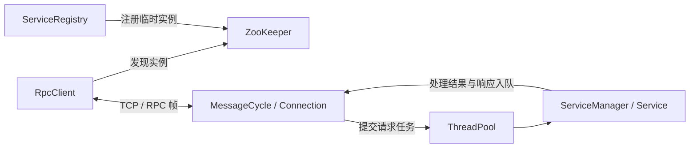

# rpc-tutorial（CookRPC）

基于 C++17 的教学型 RPC 项目，通过一个可运行的 `Echo` 服务展示 TCP 通信、服务注册与发现、负载均衡、业务调度和协议编解码。

项目提供服务端、客户端、压测工具和自动化测试，适合学习 RPC 调用链及并发资源管理。RPC 收发链路支持可配置的 Zstd 压缩与 AES-256-GCM 消息加密，并提供服务端请求限流和客户端实例熔断。示例启用压缩，加密需显式配置共享密钥。

## 目录

- [功能与架构](#功能与架构)
- [环境要求](#环境要求)
- [快速开始](#快速开始)
- [配置说明](#配置说明)
- [构建选项](#构建选项)
- [测试](#测试)
- [压力测试](#压力测试)
- [项目结构](#项目结构)
- [实现边界](#实现边界)
- [开发说明](#开发说明)

## 功能与架构

| 模块 | 当前能力 |
| --- | --- |
| 网络 | Linux epoll 事件循环、非阻塞 TCP、短读与短写、EOF 数据保留、连接容量与响应队列限制 |
| 协议 | 12 字节固定头部、网络字节序、请求序列号、最大 1 MiB body、超限响应转换 |
| 服务发现 | 客户端独立 ZooKeeper 会话、查询快照、端点切换成功后提交配置 |
| 服务注册 | 持久服务目录、临时实例节点、会话所有权校验、watch 等待与过期恢复 |
| 负载均衡 | `random`、`round`、`weight`；当前 `weight` 按等权轮询执行 |
| 线程池 | 任务优先级、队列背压、按需扩缩容、统计、排空关闭和限时等待 |
| 序列化 | nlohmann-json 与 Protobuf 适配器；示例 `RpcService.Echo` 使用 JSON |
| 流量保护 | 服务端令牌桶限流、客户端按实例熔断、冷却后的单次探测 |
| 传输编码 | 阈值压缩、AES-256-GCM、认证帧头与方向、压缩与加密配置校验 |
| 通用组件 | spdlog 同步日志、Zstd 与 OpenSSL 组件 |



fd 或 socket 资源不足时，监听读事件暂停并按 100 毫秒至 1 秒退避恢复，已有连接继续处理。服务端事件线程每轮最多接入 64 个连接，并负责连接的读写、事件注销和关闭；工作线程解码、解压和解密请求，处理业务并编码、提交响应帧。客户端在一条 TCP 连接上串行执行调用，发送与接收均使用明确的等待期限。

## 环境要求

- Linux，支持 C++17 的 GCC 或 Clang，CMake 3.20 及以上。
- Threads、OpenSSL、Protobuf（含 `protoc`）、fmt、spdlog、nlohmann-json、zstd、ZooKeeper C client。
- 构建测试时需要 GoogleTest 和 Python 3；`BUILD_TESTING` 默认开启。
- 运行示例与压测时需要可访问的 ZooKeeper 服务，示例地址为 `localhost:2181`。
- 可选真实集成测试还需要 Java 和 ZooKeeper 服务端 jars。
- 构建与压测脚本需要 Bash 和 GNU 命令行工具，压测脚本还需要 util-linux 的 `setsid`。

ZooKeeper C client 必须启用同步 API。使用 vcpkg 时安装 `zookeeper[sync]`；CMake 会检查该能力，缺失时停止配置。该依赖是链接到 RPC 程序的 C 客户端库，不会安装或启动 ZooKeeper 服务端。

当前示例通过 ZooKeeper 注册和发现服务，运行 RPC 服务端、客户端及压测工具时必须有可访问的 ZooKeeper 服务。仅构建项目和运行常规测试不要求启动外部 ZooKeeper。

## 快速开始

以下操作从仓库根目录开始。先构建 RPC 程序，再启动 ZooKeeper、RPC 服务端和客户端。

### 1. 安装依赖并构建

```bash
export VCPKG_ROOT=/path/to/vcpkg
export VCPKG_TARGET_TRIPLET=x64-linux

"$VCPKG_ROOT/vcpkg" install openssl protobuf fmt spdlog nlohmann-json \
  zstd 'zookeeper[sync]' gtest --triplet "$VCPKG_TARGET_TRIPLET"

./rpc_build.sh
```

如果通过系统包或其他依赖前缀安装，可以直接配置 CMake：

```bash
cmake -S . -B build -DCMAKE_BUILD_TYPE=Debug
cmake --build build --parallel
```

依赖不在默认搜索路径时，为上述配置命令追加 `-DCMAKE_PREFIX_PATH=/path/to/dependency-prefix`。构建产生 `rpc_server`、`rpc_client` 和 `stress_test_client`，Protobuf 生成文件位于 `build/generated/`。

### 2. 安装并启动 ZooKeeper

如果已有可访问的 ZooKeeper，可以跳过本地安装与启动，并在下一步将服务端和客户端配置指向该服务。以下示例使用 Ubuntu / Debian 系统包，在本机前台运行一个 ZooKeeper 实例。

安装 Java 运行时、ZooKeeper 服务端及日志依赖：

```bash
sudo apt-get update
sudo apt-get install default-jre-headless zookeeper libslf4j-java
```

在仓库根目录创建本地配置和数据目录：

```bash
mkdir -p .cache/zk-local/data
cat > .cache/zk-local/zoo.cfg <<EOF
tickTime=2000
dataDir=$PWD/.cache/zk-local/data
clientPort=2181
clientPortAddress=127.0.0.1
EOF
```

在终端一启动 ZooKeeper：

```bash
java -Dzookeeper.admin.enableServer=false \
  -cp '/usr/share/java/zookeeper.jar:/usr/share/java/slf4j-simple.jar' \
  org.apache.zookeeper.server.quorum.QuorumPeerMain \
  "$PWD/.cache/zk-local/zoo.cfg"
```

该命令关闭可选的 HTTP 管理接口，RPC 只使用 ZooKeeper 客户端通信端口。保持这个终端运行；按 `Ctrl+C` 会停止 ZooKeeper。使用系统服务或其他方式管理 ZooKeeper 时，无需执行上述前台启动命令。其他发行版的安装位置可能不同，也可以使用 [ZooKeeper 官方发行包和启动指南](https://zookeeper.apache.org/doc/current/zookeeperStarted.html)。

在另一个终端检查连接：

```bash
java -cp '/usr/share/java/zookeeper.jar:/usr/share/java/slf4j-simple.jar' \
  org.apache.zookeeper.ZooKeeperMain -server 127.0.0.1:2181
```

看到 `SyncConnected` 后输入 `ls /`，能返回节点列表即表示 ZooKeeper 可用；输入 `quit` 退出检查客户端，ZooKeeper 服务端继续运行。`2181` 使用 ZooKeeper 协议，后面的 `8989` 使用本项目 RPC 协议，均不能通过浏览器访问 `http://localhost:端口/`。

### 3. 核对示例配置

确认 ZooKeeper 已启动，并核对以下三个文件：

- [rpc_server.json](config/rpc_server.json)：监听地址、线程池和 ZooKeeper 连接参数。
- [servers.json](config/servers.json)：注册的服务目录名及实际可访问的 `ip:port`。
- [rpc_client.json](config/rpc_client.json)：ZooKeeper 地址和待发现的实例目录。

示例监听端口与注册地址端口均为 `8989`。修改监听地址或端口时，同步修改 `servers.json`；注册地址应是客户端可访问的地址。

连接远程 ZooKeeper 时，同步修改 `rpc_server.json` 中的 `scheduler.zk_host` / `zk_port` 和 `rpc_client.json` 中的 `zk_host` / `zk_port`。客户端和服务端必须访问同一套 ZooKeeper。跨机器调用时，`servers.json` 中的注册地址也应改成客户端可访问的服务器 IPv4 地址。

### 4. 启动 RPC 服务端

在终端二从仓库根目录执行：

```bash
cd build
./rpc_server ../config/rpc_server.json
```

保持这个终端运行。看到 `RPC server started on 0.0.0.0:8989` 表示监听和 ZooKeeper 发布均已成功；`Service registered successfully: RpcService` 仅表示进程内业务服务注册完成。

### 5. 调用 RPC 服务

在终端三从仓库根目录执行：

```bash
cd build
./rpc_client ../config/rpc_client.json "Hello, cookrpc"
```

成功时输出：

```json
{
  "echo": "Hello from cookrpc",
  "received_message": "Hello, cookrpc"
}
```

客户端调用完成后自动退出。若提示 `Failed to connect to ZooKeeper`，先检查 ZooKeeper 进程是否仍在运行、配置地址是否正确，并通过上面的检查客户端确认服务可用，再重新启动 RPC 服务端和客户端。

复用数据目录重启 ZooKeeper 后，旧会话的临时实例节点可能尚未过期。若服务端提示 `Timed out acquiring registry instance ownership`，应确认旧 RPC 实例已停止，等待旧会话过期后重试；默认会话超时为 30 秒，本地联调可等待约 35 秒再重试，无需手动删除实例节点。

ZooKeeper 注册使用覆盖排队、创建、检查和 watch 等待的总期限。结果不确定的超时会话由后台退役，关闭或过期后清理临时节点，并以新会话恢复已确认注册。

服务端接收 `SIGINT` 或 `SIGTERM` 后停止接收新请求，尝试发送在途响应，再等待业务任务完成并清理注册会话。普通 C++ 任务不能被安全强制终止，因此退出时间可能超过配置中的等待时间。

## 配置说明

### 客户端

| 参数 | 示例或缺省值 | 含义 |
| --- | --- | --- |
| `zk_host` / `zk_port` | `localhost` / `2181` | ZooKeeper 地址；端口范围为 1–65535 |
| `zk_namespace` | 示例为 `/cookrpc/cookrpc_service` | 要查询的实例目录；省略时为 `/cookrpc` |
| `server_port` | `8989` | 发现的地址未携带端口时使用的备用端口 |
| `timeout_ms` | `3000` | 每次 TCP 连接、发送或等待响应的期限，单位毫秒 |
| `retry_times` | `3` | 连接建立的重试次数，范围 0–100 |
| `load_balance_strategy` | `random` | 可选 `random`、`round`、`weight`；未知值回退到随机 |
| `zk_retry_interval` | `5` | ZooKeeper 建连等待的间隔单位，正整数秒，最多等待三个间隔 |

ZooKeeper 连接就绪后才提交新的客户端配置；提交时断开现有 TCP 连接，后续调用重新发现并连接服务。ZooKeeper 端点切换失败时保留当前配置和会话。异步任务持有共享客户端会话，销毁客户端对象后，已发起的任务仍可完成并通过 future 取得结果；实际调用在同一会话上串行执行。各 `RpcClient` 的发现会话独立，进程内的负载均衡策略由全局 `LoadBalancer` 共享。

### 服务端与注册信息

| 参数 | 当前作用 |
| --- | --- |
| `servers_ip` / `servers_port` | TCP 监听地址与端口 |
| `max_connections` | 活动连接硬上限，默认 10000；达到上限时关闭新接入连接 |
| `listen_backlog` | 传给 `listen()` 的等待队列参数，默认 1024 |
| `timeout` | 线程池退出时首次等待的毫秒数；不构成业务任务的强制执行期限 |
| `thread_pool.core_threads` / `max_threads` | 核心线程数与最大线程数 |
| `thread_pool.queue_size` | 待执行任务队列上限；设为 0 时不限制队列长度 |
| `thread_pool.keep_alive_time` | 非核心线程空闲退出时间，单位秒 |
| `scheduler.zk_host` / `zk_port` | 服务端注册与发现处理器的 ZooKeeper 地址 |
| `scheduler.retry_interval` | 毫秒值，入口转换为至少 1 秒的 ZooKeeper 等待间隔 |
| `register_config` | 服务注册配置文件路径，如 `../config/servers.json` |

监听和注册地址使用标准 IPv4 文本，配置与 socket 层采用相同校验，拒绝前导零、空白和嵌入 NUL。

数值配置只接受范围内的整数，拒绝布尔值、浮点数和溢出值。服务端及子配置全部解析、校验成功后统一提交；注册配置重新加载时替换实例列表。配置加载不代表运行中的监听地址或线程池支持热更新。

`servers.json` 的 `service_name` 决定发现目录，`registry_nodes` 决定实例地址；`service_version` 当前仅作为配置元数据保存。注册根路径固定为 `/cookrpc`，修改 `scheduler.zk_namespace` 不会改写它。

发现目录名与业务分发名称用途不同：示例从 `/cookrpc/cookrpc_service` 发现地址，再调用业务服务 `RpcService` 的 `Echo` 方法。

服务端配置中的顶层及 `scheduler.load_balance_strategy` 不参与入口的策略初始化。客户端通过自己的 `load_balance_strategy` 选择策略。

直接启动可执行程序时，相对路径以进程工作目录为基准；`register_config` 也遵循此规则。示例程序的日志目录为 `../logs`，文件日志每天零点滚动，文件名为 `cookrpc_YYYY-MM-DD.log`。使用自定义构建目录时，可为注册配置填写绝对路径。

### 压缩、加密、限流与熔断

客户端和服务端均可配置 `transport`。示例启用 Zstd 压缩，body 达到 1024 字节时尝试压缩，只有压缩后更小才使用压缩结果。两端的 `compression` 和 `encryption` 必须一致；模式不匹配、未知标志、错误密钥或认证失败会拒绝通信，不会自动退回明文。

```json
"transport": {
  "compression": true,
  "compression_threshold": 1024,
  "encryption": false
}
```

开启消息加密时，将两份配置中的 `encryption` 改成 `true`，并在启动服务端和客户端的各自终端中设置**相同**的 `COOKRPC_MASTER_KEY_HEX`。可用以下命令生成一次 32 字节密钥，再将其安全注入两端；不要分别生成两把密钥，也不要把密钥写进配置或仓库。

```bash
openssl rand -hex 32
export COOKRPC_MASTER_KEY_HEX='<同一份64个十六进制字符的密钥>'
```

RPC 加密必须使用显式共享密钥，缺失或格式错误时配置加载失败。AES-256-GCM 使用随机 nonce，并认证帧头、变换标志和请求/响应方向；认证成功后才解压和解析业务。加密连接拒绝重复或倒退的请求序列号，但没有跨连接的持久防重放、证书认证或密钥协商。该能力是消息加密，不能替代完整 TLS 会话安全。[OpenSSL AEAD 接口说明](https://docs.openssl.org/master/man3/EVP_EncryptInit/)

未启用传输变换时保留 `CRPC` 格式。启用后使用 `CRP1` 魔数、相同的 12 字节头部及一字节变换标记；编码后的 wire body 与解压后的逻辑 body 均限制为 1 MiB。业务响应超限，包括加密膨胀导致的超限，会转换为保留序列号的短错误响应；请求超限则在发送前失败。

服务端配置 `rate_limit`，令牌桶限制整个服务端进程接收的请求总速率，在投递线程池前检查。超限返回错误码 `3005`，不会断开正常连接。`requests_per_second` 为 `0` 时关闭限流；启用时 `burst` 必须大于 `0`，表示允许的突发请求数。

```json
"rate_limit": {
  "requests_per_second": 1000,
  "burst": 2000
}
```

客户端配置 `circuit_breaker`，按发现的实例地址隔离状态。连续远端建连、收发或协议失败达到阈值后暂时避开该实例；冷却结束允许一次探测，成功恢复，失败重新冷却。有效业务错误和限流响应不计入故障次数。本地套接字创建或选项初始化失败不计入实例故障，资源恢复后无需等待熔断冷却。请求、响应类型与序列化格式在建连和发送前校验，不兼容时作为本地错误返回。只有目录及全部实例数据读取成功时，才按发现结果清理缺失实例的熔断状态；部分读取失败会保留原有故障历史。`failure_threshold` 为 `0` 时关闭熔断。

```json
"circuit_breaker": {
  "failure_threshold": 5,
  "reset_timeout_ms": 5000
}
```

已发送的业务请求不会自动重试，调用方应根据业务幂等性决定是否再次调用。限流会影响压测成功率；测量容量时应明确记录或调整限流配置。`ServiceManager::HandleRpcRequestAsync()` 返回 `future<AsyncResult>`，结果包含 `success` 和拥有数据的 `data`，无需传入供后台任务写入的引用。

## 构建选项

`rpc_build.sh` 支持以下环境变量：

| 变量 | 含义 |
| --- | --- |
| `BUILD_DIR` | 构建目录；默认仓库下的 `build/`，相对路径按调用者目录解析 |
| `BUILD_TYPE` / `BUILD_JOBS` | 构建类型与并行任务数；默认 `Debug` 与 `nproc` |
| `VCPKG_ROOT` | vcpkg 根目录；未提供时尝试从 `PATH` 查找 |
| `CMAKE_TOOLCHAIN_FILE` | 显式指定工具链，优先于自动选择的 vcpkg 工具链 |
| `VCPKG_TARGET_TRIPLET` | 依赖目标 triplet，优先于 `VCPKG_DEFAULT_TRIPLET` 和宿主默认值 |

脚本将选定 triplet 显式传给 CMake，并记录工具链、triplet、依赖前缀、编译器及生成器的环境签名。签名改变后，会清除该构建目录的 `CMakeCache.txt` 和 `CMakeFiles` 再配置。

CMake 提供 `BUILD_TESTING` 和 `RPC_ENABLE_LIVE_TESTS` 两个测试开关。只构建程序时，可使用独立目录并设置 `-DBUILD_TESTING=OFF`。

## 测试

### 常规测试

```bash
ctest --test-dir build --output-on-failure
```

常规测试涵盖协议、序列化、配置、服务管理、负载均衡、线程池、压缩、加密、日志滚动和脚本。Linux 下还包含真实本地 TCP 测试，以及通过替换 ZooKeeper C API 控制交错的发现与注册测试；这些测试不要求启动外部 ZooKeeper。压测客户端回归使用真实 TCP，仅替换发现 API，验证错误响应类型计为失败而不会终止进程。

### 真实 TCP 与 ZooKeeper 集成测试

```bash
cmake -S . -B build -DRPC_ENABLE_LIVE_TESTS=ON
cmake --build build --parallel
ctest --test-dir build -R live_tcp_zookeeper --output-on-failure
```

该测试临时启动 ZooKeeper，验证慢读背压、真实发现与调用、会话过期后的自动注册，以及 ZooKeeper 和 TCP 服务重启后的可发现性。缺少 Java 或默认 jars 时显示跳过，可通过 `ZK_SERVER_CLASSPATH` 指定安装位置。

需要保留日志时：

```bash
python3 rpc_src/test/live_test.py \
  --driver build/live_integration_test --artifacts .cache/live-test
```

### Sanitizer 检查

分别构建 ASan/UBSan 和 TSan，避免混用。使用 vcpkg 时，为下列配置命令追加相同的工具链和 triplet 参数：

```bash
cmake -S . -B build-asan -DCMAKE_BUILD_TYPE=Debug \
  -DCMAKE_CXX_FLAGS="-fsanitize=address,undefined -fno-omit-frame-pointer" \
  -DCMAKE_EXE_LINKER_FLAGS="-fsanitize=address,undefined" \
  -DCMAKE_GTEST_DISCOVER_TESTS_DISCOVERY_MODE=PRE_TEST
cmake --build build-asan --parallel
ASAN_OPTIONS=detect_leaks=1:halt_on_error=1 \
  UBSAN_OPTIONS=halt_on_error=1 ctest --test-dir build-asan --output-on-failure

cmake -S . -B build-tsan -DCMAKE_BUILD_TYPE=Debug \
  -DCMAKE_CXX_FLAGS="-fsanitize=thread -fno-omit-frame-pointer" \
  -DCMAKE_EXE_LINKER_FLAGS="-fsanitize=thread" \
  -DCMAKE_GTEST_DISCOVER_TESTS_DISCOVERY_MODE=PRE_TEST
cmake --build build-tsan --parallel
TSAN_OPTIONS=halt_on_error=1 ctest --test-dir build-tsan --output-on-failure
```

部分 Linux 环境存在 TSan 地址映射冲突，可仅为测试进程关闭 ASLR。真实测试脚本提供 `--no-aslr` 选项；常规测试可在对应环境中通过 `setarch` 启动。

## 压力测试

ZooKeeper 和 RPC 服务均已就绪时：

```bash
./stress_test.sh --threads 8 --requests 50000 --payload-size 256
```

让脚本管理本地服务端的启动与清理：

```bash
./stress_test.sh --start-server --threads 8 --requests 50000
```

使用 `--build` 可先构建。配置、构建目录和服务端日志路径均在切换目录前按调用者工作目录规范化，支持带空格的路径；例如：

```bash
./stress_test.sh --build-dir './out build' \
  --client-config './my configs/client.json' \
  --server-config './my configs/server.json' \
  --server-log './test logs/server.log' --start-server
```

压测使用多个独立客户端与长连接，并发调用 `RpcService.Echo`，校验返回消息，输出成功率、吞吐量、平均延迟及 P50/P95/P99。连接准备不计入测试窗口；延迟样本包含成功与失败调用。错误类型、缺失字段和不匹配的 Echo 值均计为失败，压测返回非零状态。具体参数与环境变量见 `./stress_test.sh --help`。

脚本跟踪自己启动的构建、客户端和服务端进程组；`SIGINT` 与 `SIGTERM` 分别返回 130、143，并清理这些进程及其子进程。停止宽限期默认 10 秒，可通过 `--shutdown-timeout` 或 `SHUTDOWN_TIMEOUT_SECONDS` 设置为 1–60 秒；宽限期后仍未退出的进程会被强制结束，可能中止在途请求。

## 项目结构

```text
cmake/                      依赖查找与目标配置辅助模块
config/                     服务端、客户端及注册节点配置
protos/                     Protobuf 消息定义
rpc_src/
  core/                     程序入口、客户端、Echo 示例、错误码
  network/                  socket、连接与事件循环
  conn_balancer/            负载均衡与 ZooKeeper 服务发现
  registry/                 ZooKeeper 服务注册与恢复
  thread_pool/              线程池与单例访问入口
  load_config/              配置解析
  protocol/                 RPC 帧编解码
  serializer/               JSON / Protobuf 适配器
  compress_data/            Zstd 组件
  encrypt/                  AES-256-GCM 组件
  tools/                    压测客户端
  test/                     单元、并发、脚本及真实集成测试
utils/                      日志与工具函数
```

## 实现边界

- 消息加密使用显式共享密钥，不提供 TLS、证书认证、密钥轮换或跨连接持久防重放；独立 AES 组件的随机缺省密钥仅供当前进程使用，RPC 加密不会使用该缺省值。
- 外层 RPC 帧使用自定义二进制协议；`protos/message.proto` 提供生成消息和序列化测试，不替代当前外层协议。
- `weight` 当前等权执行，服务发现使用实时查询，没有动态负载权重、发现缓存或长期实例列表 watch。
- 同一会话的调用串行执行；`AsyncCall` 由后台任务持有共享会话并调用同步接口，不提供调用级取消，future 的析构可能等待任务完成。
- 日志当前为同步写入；限流为进程总配额，熔断为客户端会话内的实例状态，没有按方法配额、自动业务重试、调用级取消或独立监控服务。
- 网络层保留 macOS/kqueue 分支，完整构建脚本及集成测试以 Linux 为验证环境。

## 开发说明

内部头文件使用 `#include "connection.h"` 等不带模块目录的形式，搜索路径由 `rpc_common` 的 CMake 配置提供。公共库使用显式源码列表，新增模块时同步维护主 `CMakeLists.txt` 中的源码和 include 路径；第三方头文件保持其标准路径。

构建入口定义公共库和三个程序；依赖查找位于 `cmake/RpcDependencies.cmake`，目标公共设置位于 `cmake/RpcTargets.cmake`，测试目标由 `rpc_src/test/CMakeLists.txt` 管理。所有可执行文件保留在构建目录顶层。

修改 `.proto` 后重新构建，CMake 会在构建目录生成 C++ 文件。提交前检查 `git diff --check`，并根据变更运行相关测试及完整 CTest。

设计原理、实现边界和面试问答见 [项目问题答案](docs/项目问题答案.md)；题目列表见 [项目问题](docs/项目问题.md)。
